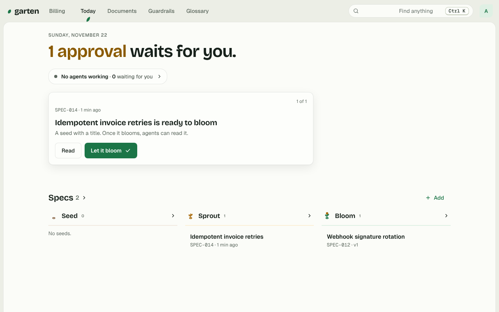
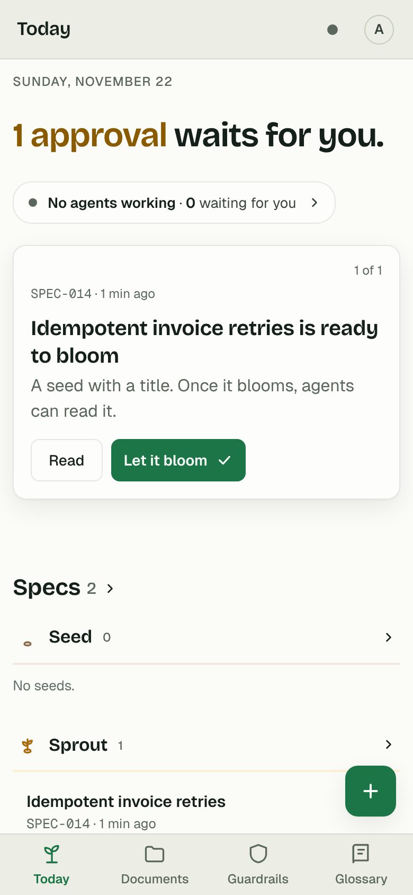
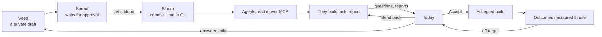
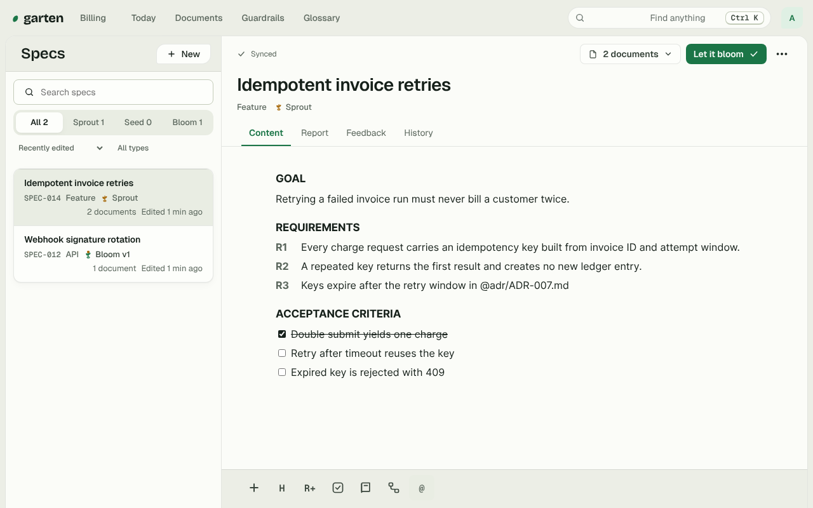
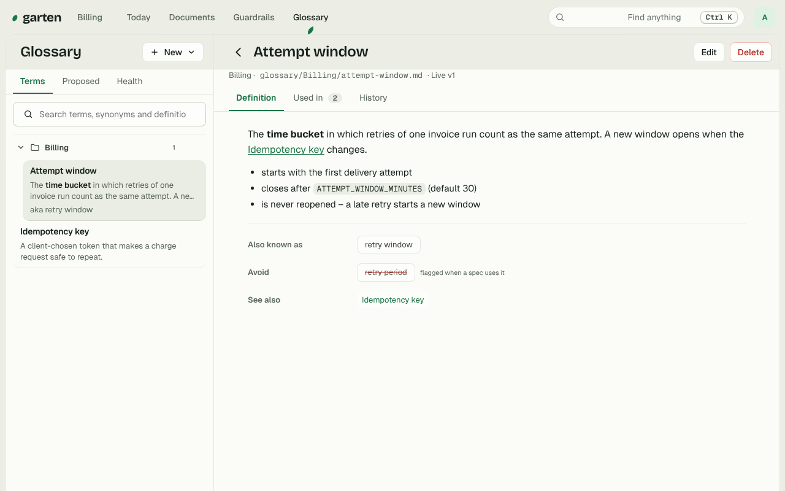
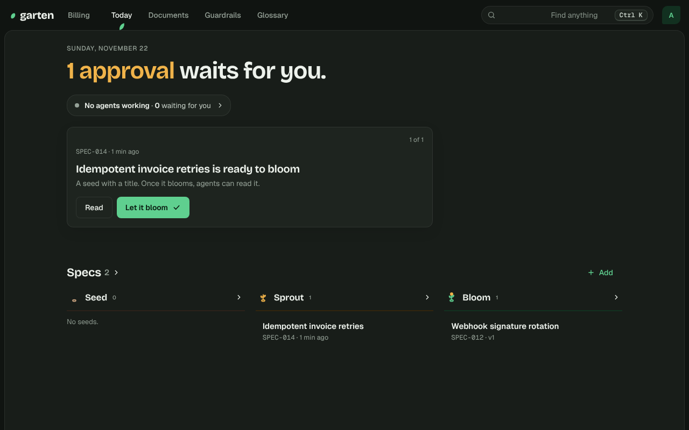

# Garten

**Specs your AI agents can trust.** Garten is a self-hosted place where your team writes specifications, decides together, and hands coding agents exactly what was approved – over MCP, with every version in Git.

[](https://github.com/Kogoro/Garten/actions/workflows/ci.yml) [](LICENSE)

<p>
  
  
</p>

## Why Garten

- **Agents build from what you approved, not from a chat log.** A spec is a private draft until an approver lets it bloom. Only then do agents see it – as a fixed version they can cite.
- **Agents ask instead of guessing.** When a spec leaves a choice open, the agent asks. The question lands on _Today_, you answer (also offline), and the answer can go straight into the spec.
- **You see what was built – and accept it.** Agents report every requirement and acceptance criterion as met, deviating or open, with evidence and re-runnable checks. An approver accepts the build or sends it back with a note, straight onto the agents' work list.
- **You see what it changed.** Specs name their outcomes; agents make each one measurable, monitoring reports the numbers, and an outcome off target comes back to _Today_ – the loop from use back to the spec is closed.
- **Your words, your rules.** A glossary with full definitions and words to avoid, and guardrails (_Always_ / _Never_) that every agent follows on every task.
- **Everything is Markdown in Git.** Each approved version is one commit and one tag in your team's repository, optionally pushed to the project repository itself.
- **Yours to run.** One container or one install script, SQLite, no external services. Works offline as an installable app on desktop and phone.

## How it works



Everything a team writes grows through three stages, shown everywhere as one icon: **Seed** (only you see it), **Sprout** (waiting for an approver), **Bloom** (agents can read it).

## Quick start

With Docker:

```bash
curl -fsSLO https://raw.githubusercontent.com/Kogoro/Garten/main/docker-compose.yml
ADMIN_PASSWORD='choose-a-long-password' docker compose up -d
```

Open <http://localhost:3000> and sign in as `admin@localhost`. Without `ADMIN_PASSWORD` a password is generated and printed by `docker compose logs specs`. The first team starts with example specs, documents, glossary words and guardrails (`SEED_DEMO=0` starts empty). A short tour shows you around on the first visit.

On Debian 12/13 or Ubuntu 24.04 (VM, server or LXC), as root:

```bash
bash -c "$(curl -fsSL https://raw.githubusercontent.com/Kogoro/Garten/main/scripts/install-debian.sh)"
```

This installs the latest release as the service `garten` on port 3000 and writes the sign-in to `/root/garten.creds`. Afterwards `garten update`, `garten backup`, `garten info`, `garten logs` and `garten url https://specs.example.org` do what they say.

## Connect an agent

```bash
claude mcp add --transport http garten https://specs.example.org/mcp
```

Claude opens a browser to sign in and to pick the team. Instead of OAuth you can create a personal token under _Account & agent access_. Agents act with the rights of the person who connected them and can never let anything bloom themselves.

What agents get: the team context in one call (vision, strategy, glossary, guardrails), the specs in bloom and their acceptance criteria, a work list of what is new or changed, and tools to ask decisions, give feedback, report implementations and register checks. _Members & Git → Agent setup_ gives you a ready-made prompt and `.mcp.json` for a Claude Code routine that starts whenever a spec blooms.

## What's inside

<p>
  
  
</p>

- **Today** – one sentence of what waits for you, the agents at work, a stack of decisions, feedback, approvals and proposals, and every spec by stage.
- **Specs** – block editor or forms per spec type (feature, API, UI, data model, NFR, integration, ADR, your own types), Mermaid diagrams, images (paste, drop or pick a file; released into Git next to the spec), requirements, checklists; links to documents with `@` and to glossary words with `#`.
- **Documents** – vision and strategy on top, then ADRs, schemas and notes in folders.
- **Guardrails** – one file per rule with an id, _Always_ or _Never_, and why. A new or reworded rule puts built specs back on the agents' work list.
- **Glossary** – one file per word: definition, other names, words to avoid, not-to-be-confused-with, see-also. Health checks find conflicting definitions and words to avoid in specs. Import and export as ZIP or CSV.
- **Agents** – who is working on what, the implementation of every spec in bloom, checks, and the history of the last weeks.
- **Teams** – invitations, roles (viewer, editor, approver, admin), one Git repository per team, optional single sign-on (OpenID Connect).
- **Sharing between teams** – parent teams pass on their guardrails, vision and glossary to child teams, pinned to a version the child accepts; any team shares documents, folders and specs with others, linked at one version with _Update available_; specs say which spec of another team they implement, and the owner sees the reports rolled up.
- **Offline-first** – install it on your phone, write and answer without a connection; changes sync when you are back.



## Self-hosting

**Requirements.** Docker, or Node.js 22.13+ and Git (the Debian installer sets both up). Data lives in one volume: an SQLite database and one Git repository per team. Images are published for amd64 and arm64.

**Configuration.** Environment variables, all listed with comments in [`docker-compose.yml`](docker-compose.yml). The ones you will most likely set:

| Variable                                              | What it does                                                              |
| ----------------------------------------------------- | ------------------------------------------------------------------------- |
| `PUBLIC_URL`                                          | The address people and agents use, e.g. `https://specs.example.org`       |
| `TRUST_PROXY`                                         | `1` behind one reverse proxy (Caddy, nginx, a tunnel)                     |
| `ADMIN_EMAIL`, `ADMIN_PASSWORD`                       | The first admin, created on an empty database                             |
| `SECRET_KEY`                                          | Encrypts Git tokens and SSH keys at rest; keep it outside the data volume |
| `SMTP_URL`, `SMTP_FROM`                               | Optional: invitation e-mails and the feedback digest                      |
| `OIDC_ISSUER`, `OIDC_CLIENT_ID`, `OIDC_CLIENT_SECRET` | Optional: single sign-on with Keycloak, Authentik, Google, Entra …        |
| `SEED_DEMO`                                           | `1` fills an empty database with examples, `0` starts empty               |

**HTTPS.** The offline mode and installing on a phone need HTTPS (except on `localhost`). Put a TLS proxy in front and set `PUBLIC_URL` and `TRUST_PROXY=1`:

```caddy
specs.example.org {
	reverse_proxy 127.0.0.1:3000
}
```

No public address? `scripts/go-public.sh` starts a Cloudflare tunnel and sets `PUBLIC_URL` for you – handy for a phone on the road or a cloud agent. It refuses to run while the admin still has a demo password.

**Updates and backups.** Docker: `docker compose pull && docker compose up -d`, or pin a version with `GARTEN_IMAGE=ghcr.io/kogoro/garten:<version>`. Debian: `garten update` prepares the new version next to the running one, switches over, and rolls back by itself if the new one does not answer. `garten backup` writes a consistent snapshot of the database, the team repositories and the settings while the server keeps running.

**Security.** Strict content security policy (only its own scripts, no third-party hosts – fonts are bundled), scrypt passwords with rate-limited sign-in, encrypted secrets, signed webhooks, SSRF guards for Git remotes and webhooks, and an audit log of sign-ins, roles, tokens, approvals and settings. Agents are told to treat spec content as data, not as instructions.

## Documentation

- [Reference (German)](docs/REFERENCE.de.md) – every feature, setting and workflow in detail: teams and roles, Git per team, MCP tools, agent routines, checks, HTTPS, backups, releases, known gaps.
- [Design system](docs/DESIGN-SYSTEM.md) and [words in the interface](docs/UI-VOCABULARY.md).
- [The clickable design mockup](docs/fluent-mockup.html) the interface is built from.

## Development

```bash
npm ci && npm --prefix web ci
npm start                    # the server on :3000 (needs a build: npm run build)
cd web && npm run dev        # Vite dev server with a proxy to :3000
npm test                     # builds the frontend, then API, unit, component and browser tests
npm run check                # lint + typecheck + format:check, before every push
npm run ux-audit             # accessibility, layout and performance on phone and desktop
```

React 19 and TypeScript (Vite, PWA) in `web/`, Node with Express, `node:sqlite` and `git` in `server/`, shared code in `shared/`.

## Status

Garten is young. Some paths are only tested against local stand-ins: the cloud routine loop, Git remotes on GitHub or GitLab, and touch devices. Guardrails and checks are reported, not enforced. Permissions are per team, not per spec, and there is no two-factor sign-in yet. The [reference](docs/REFERENCE.de.md#bekannte-lücken) lists the known gaps.

## License

[MIT](LICENSE)
