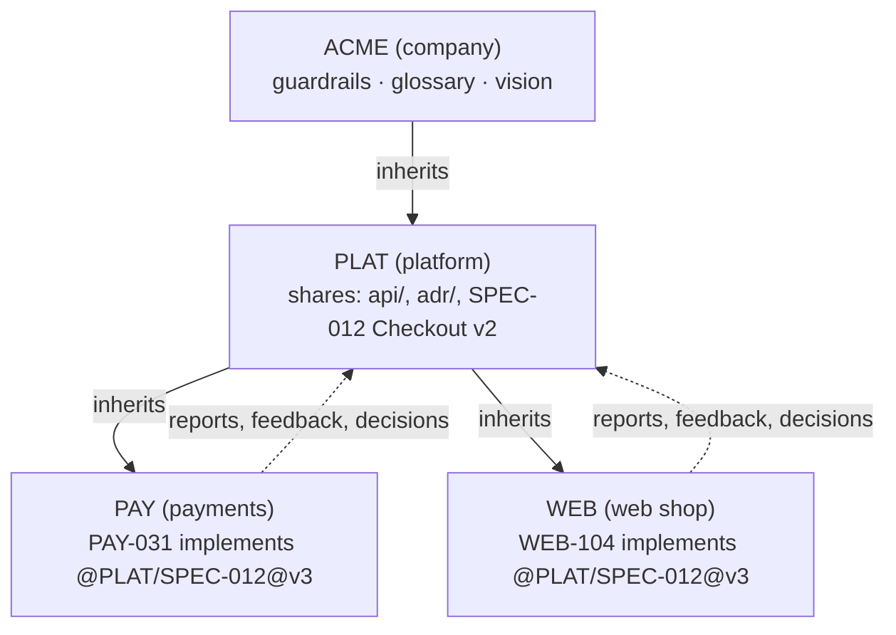

# Shared specs: parent and child teams

Status: **concept**, nothing of this is built yet. Open questions are at the end.

## The problem

Everything in Garten belongs to exactly one team: specs, documents, folders, the glossary, the guardrails, the Git repository and every agent token. That isolation is a feature, but real organisations are nested:

- a **company** has guardrails every team must follow ("never store card numbers", "all services log in JSON") and a shared vocabulary,
- a **platform team** owns API contracts, ADRs and data models that product teams build against,
- a **program** writes one spec ("Checkout v2") that three teams implement in their own repositories.

Today the only cross-team mechanism is the instance-wide glossary, which teams import as copies. Everything else is copy & paste, and copies drift.

## Recommendation in one paragraph

Teams form a **tree** (each team has at most one parent team). A team can **share** released specs, documents and folders with its child teams. Child teams see them as **inherited**: read-only, always the released version, addressed with the parent's team key (`@PLAT/SPEC-012`, `@PLAT/adr/ADR-007.md`). Foundation documents travel down automatically and are **layered** (guardrails add up, glossary terms resolve nearest-first). A child spec can say it **implements** a parent spec; the parent sees the reports of all its children rolled up, and a new parent version puts the child spec back on the work list. Content flows **down**, feedback, decisions and reports flow **up**. A child that needs to change something **adopts** it as its own copy, which remembers its source and offers updates.

Only released content crosses a team boundary. Drafts stay private, exactly as today.



## Why this model and not another

| Approach                                                        | How it works                                                  | Verdict                                                                                                                                                                                      |
| --------------------------------------------------------------- | ------------------------------------------------------------- | -------------------------------------------------------------------------------------------------------------------------------------------------------------------------------------------- |
| **Copy on share** (like the global glossary)                    | The child imports a copy                                      | Simple, but drift is the default; nobody knows which copy is current. Kept only as the escape hatch (_Adopt_).                                                                               |
| **Shared ownership** (one item belongs to several teams)        | Item rows get several owners                                  | Breaks the per-team Git repository, the per-team roles and the per-team agent tokens all at once. Every permission check would need rewriting. Rejected.                                     |
| **Live link to released versions** (recommended)                | The child references the parent's released version, read-only | One source of truth, fits the existing release model (Git commit + tag per version), every child release can name the exact version it was built against.                                    |
| Arbitrary sharing between any two teams (graph instead of tree) | Team A shares with team B                                     | Tempting, but layering guardrails and glossary needs a clear order. A tree gives "nearest wins" for free. A later "share with sibling" can be added on top of the tree; the reverse is hard. |

## Concepts and words

Following `docs/UI-VOCABULARY.md`: one word per idea.

| Idea                                                     | Word                                        | Not                           |
| -------------------------------------------------------- | ------------------------------------------- | ----------------------------- |
| The team above / below in the tree                       | **Parent team** / **Child team**            | org, sub-team, workspace      |
| A parent makes released content visible to its children  | **Share** (_Share with child teams_)        | publish, expose               |
| What a child sees from its ancestors                     | **Inherited** (chip _From PLAT_)            | shared-in, external, imported |
| A child spec builds (part of) a parent spec              | **Implements** (front matter `implements:`) | child of, realises, epic      |
| A child takes an inherited item as its own editable copy | **Adopt** (_Adopt as own copy_)             | fork, clone, import           |
| A child stays on one version of an inherited item        | **Pin** (_Pinned to v3_)                    | lock, freeze                  |

## 1. The team tree

- `teams.parent_id` (nullable). Depth limited to 4 levels; no cycles (checked on every change).
- **Linking needs both sides:** the parent's admin sends a link request, the child's admin accepts it (_Team → Parent team_). An instance admin can link directly. Rationale: the child agrees to inherit binding guardrails, and the parent gets to read its children's reports on specs they implement.
- **Unlinking** can be done by either admin. The child is asked whether to _Adopt_ the inherited items it still uses (they become its own documents with `origin:` front matter) or drop them.
- Deleting a team with children: the children move up to the grandparent (or become roots). Never cascade.
- Membership is **not** inherited. Being an approver in PLAT does not make you anything in PAY. (Option for later: "parent admins can read child teams".)

## 2. What can be shared

| Item                                                                            | Shared how                                                         | Notes                                                                        |
| ------------------------------------------------------------------------------- | ------------------------------------------------------------------ | ---------------------------------------------------------------------------- |
| Foundation documents (`vision.md`, `strategy.md`, `guardrails.md`, pinned docs) | **Always**, automatically, to all descendants                      | Layered, see section 3                                                       |
| Glossary terms                                                                  | **Always**, automatically                                          | Layered, nearest-first                                                       |
| Spec types (custom)                                                             | **Always**                                                         | A child can create specs of a parent's type; the type is labeled _From PLAT_ |
| A document                                                                      | Explicit share                                                     | Read-only for children                                                       |
| A folder                                                                        | Explicit share, includes everything below it, also later additions | The usual case: share `api/` or `adr/` once                                  |
| A spec                                                                          | Explicit share                                                     | Only released versions; children can link it and implement it                |

A share has an **audience**: _child teams_ (one level) or _all descendant teams_ (default). Sharing is a team-admin or approver right in the parent (same as releasing).

Table `shares (team_id, item_id, kind, audience, created_by, created_at)`; a folder share matches by path prefix, so moves and renames in the parent (which already rewrite links) just update the share row.

## 3. Layering of foundation documents

Agents call `get_team_context()` once. For a child team it now returns, top-down:

```
# Team context – PAY  (inherits from ACME › PLAT)

> GUARDRAILS are binding. Rules from parent teams cannot be relaxed here.

## Guardrails
### From ACME
- ACME/G1: Never store card numbers.
### From PLAT
- PLAT/G3: Every public endpoint is documented in api/.
### PAY
- G1: …

## Vision / Strategy   (own first, then "From PLAT", "From ACME" in collapsed form)
## Glossary            (merged, nearest definition wins, source team in every entry)
```

Rules:

- **Guardrails add up.** Rule ids are prefixed with the team key (`PLAT/G3`), so reports (which already record the guardrails they were built against) stay unambiguous. A child cannot delete or reword a parent rule; to disagree it uses **feedback** on the parent's guardrails (flows up, see section 6). A new or reworded parent rule triggers `guardrails_changed` in every descendant, exactly like an own rule does today.
- **Glossary: nearest definition wins.** If PAY defines "Account" and ACME does too, PAY's wins inside PAY. The _Health_ tab shows this as _Shadows ACME's term_ so it is a conscious choice; `avoid` words of all ancestors still apply.
- **Vision and strategy** are context, not rules: the own ones come first, ancestors' follow.
- The current **global glossary** becomes unnecessary in the long run: it is the glossary of a root team. (Migration can wait; both can coexist.)

## 4. Inherited documents and specs (read-only references)

**Addressing.** Inherited items are referenced with the owning team's key: `@PLAT/SPEC-012`, `@PLAT/api/payments.yaml`. The prefix makes collisions impossible and is readable in Markdown. The `@` mention menu in the editor gets a section _From parent teams_.

**Version on link.** A link to an inherited item is stored as `@PLAT/api/payments.yaml` (follow latest) or `@PLAT/api/payments.yaml@v4` (pinned). When the child **releases** a spec, the server resolves every inherited link to the exact released version and writes it into the front matter:

```yaml
documents:
  - api/internal-notes.md
  - '@PLAT/api/payments.yaml@v4'
implements: '@PLAT/SPEC-012@v3'
```

So every released child spec is reproducible: an agent reading PAY-031 v2 next year gets the same `payments.yaml` it was written against.

**In the child's Git repository.** Inherited items that released specs link to, plus inherited foundation documents, are written into the child's repository under `<root>/inherited/<KEY>/…` with an `origin: PLAT/api/payments.yaml@v4` front-matter line. Reason: the development repository then contains everything an agent needs, even without MCP, and the child's history shows when an inherited item changed. A parent release that affects followers of "latest" produces one debounced commit per child (`Inherited from PLAT: api/payments.yaml v5`), the same mechanism as the foundation auto-release.

**Pinned items** do not move. When the parent releases a newer version, the child sees _Update available (v5)_ with a diff (reuses the glossary _Health_ pattern) and decides.

**Parent revokes or unshares.** Released child specs keep their snapshot (it is in their Git history). The child sees _Revoked by PLAT_ under _Needs attention_; releasing a new child version that still links it shows a warning and asks to adopt or remove the link.

**In the app.** The documents tree gets a section per ancestor (_From PLAT_), read-only, with the version and _Adopt as own copy_ in the menu. Offline: inherited items are synced like own items but in a separate read-only stream per ancestor (`inheritedSince`, own cursor per source team), and only released bodies are sent.

## 5. Parent and child specs (`implements`)

This is the actual parent-child relationship between specs.

- A child spec names the parent spec it implements: `implements: @PLAT/SPEC-012@v3`. The parent spec does not need to know its children in advance. Within one team the same field works without prefix (`implements: SPEC-007`), which gives epics and sub-specs for free.
- _New spec implementing this…_ in the menu of an inherited spec creates a child draft with the link, the type, and the parent's acceptance criteria as a starting checklist (`get_criteria` already extracts them).
- **Rollup in the parent.** The parent spec's report view and the Garden show _Implemented by_: one row per child spec with its team, the parent version it implements, and its latest report status (`implemented`, `partial`, `blocked` …). The parent spec counts as implemented when all child specs report `implemented` against the current parent version. The parent never sees the child's drafts, only these released child specs and their reports.
- **A new parent version** puts every child spec implementing an older version on the child's work list with a new state `parent_changed` (with `get_spec_changes` showing the parent diff), analogous to `guardrails_changed`.
- **Criteria mapping (optional, later).** A child criterion can reference a parent criterion (`AC2 → @PLAT/SPEC-012#AC4`), so the rollup can show which parent criteria are covered by which team.

## 6. What flows up

Content flows down; signals flow up:

- **Feedback** on an inherited spec or document (from a child member or a child's agent via `add_feedback`) lands in the **parent's** feedback queue, labeled with the source team. The parent answers; the child sees the answer.
- **Decisions** (`request_decision`) on an inherited spec: same. The child agent's work list shows `decision_answered` when the parent answers.
- **Reports** of child specs that implement a parent spec are readable by the parent (rollup above).
- Rate limits are counted per writing team, so a busy child cannot flood the parent.

## 7. Permissions

| Action                                  | Who                                                                   |
| --------------------------------------- | --------------------------------------------------------------------- |
| Request / accept a parent link          | Team admins of both teams (or an instance admin)                      |
| Share / unshare items                   | Approver or admin of the owning team                                  |
| Read inherited items                    | Every member (and agent) of a descendant team                         |
| Edit an inherited item                  | Nobody in the child; only in the owning team                          |
| Adopt as own copy                       | Editor or above in the child                                          |
| Pin / unpin, accept updates             | Approver or above in the child (it changes what agents build against) |
| Feedback / decisions on inherited items | Same rights as on own items, answered by the owning team              |

Agent tokens stay bound to one team. An agent of PAY reads inherited content through PAY's MCP server; it never gets a token for PLAT.

## 8. MCP changes

- `get_team_context` – layered, as in section 3.
- `list_specs`, `list_documents` – inherited items included, with `team: "PLAT"`, `inherited: true`, `version`, `pinned`. Optional `include_inherited=false`.
- `get_spec('@PLAT/SPEC-012')`, `get_document('@PLAT/api/payments.yaml')` – the version the child follows or is pinned to; `version` parameter as today.
- `get_glossary` – merged, every entry with its source team.
- `get_work_list` – new state `parent_changed`; inherited specs themselves are never on a child's work list (the child implements its own spec).
- `create_draft_spec` – accepts `implements`.
- `add_feedback`, `request_decision` – accept inherited ids; routed to the owner.

## 9. Data model sketch

```sql
ALTER TABLE teams ADD COLUMN parent_id TEXT REFERENCES teams(id);
CREATE TABLE team_links (            -- pending link requests
  parent_id TEXT, child_id TEXT, requested_by TEXT, created_at TEXT,
  PRIMARY KEY (parent_id, child_id));
CREATE TABLE shares (
  team_id TEXT, item_id TEXT, kind TEXT,           -- spec | doc | folder
  audience TEXT NOT NULL DEFAULT 'descendants',    -- children | descendants
  created_by TEXT, created_at TEXT,
  PRIMARY KEY (team_id, item_id));
CREATE TABLE inherited_pins (        -- only pinned items; everything else follows latest
  team_id TEXT, source_team_id TEXT, item_id TEXT, version INTEGER,
  pinned_by TEXT, pinned_at TEXT,
  PRIMARY KEY (team_id, source_team_id, item_id));
ALTER TABLE items ADD COLUMN implements TEXT;      -- "@PLAT/SPEC-012@3" or "SPEC-007@2"
ALTER TABLE items ADD COLUMN origin TEXT;          -- adopted copies: "PLAT/api/payments.yaml@4"
ALTER TABLE feedback ADD COLUMN from_team_id TEXT; -- feedback that came up from a child team
```

Inherited content is **not** copied into the child's `items` table: it is read from the parent's released Git versions (as `get_spec` already does for own specs) and cached. Only the child's Git repository gets materialised copies (section 4).

## 10. Rollout in steps

Each step is useful on its own:

1. **Team tree + inherited foundation.** `parent_id`, link requests, layered `get_team_context`, inherited guardrails and glossary. Biggest value (company-wide rules), smallest surface; no new item kinds.
2. **Shared documents and folders.** Shares, `@KEY/…` links with versions resolved at release, read-only tree section, `inherited/` in the child repository, update offers for pinned items.
3. **`implements` and rollup.** Child specs implementing parent specs, `parent_changed`, _Implemented by_ in the parent, feedback and decisions routed up.
4. **Adopt, unlink, criteria mapping, global glossary as root team.**

## 11. Edge cases to keep in mind

- **Parent pushes to the same Git remote as the child** (monorepo). The `inherited/` copies would duplicate the parent's own files; a team setting _Parent is in the same repository_ links instead of copying.
- **Moving a team in the tree** changes its guardrails. Treat it like a guardrail change: `guardrails_changed` for all implemented specs.
- **Shared spec with a custom type** the child does not have: types are inherited (section 2), so it renders; if the parent deletes the type, the released Markdown still renders as plain blocks.
- **Glossary `avoid` conflicts:** a parent says "never say _client_", a child defines _Client_. Health shows the conflict; the parent rule wins for agents unless the child term is explicitly marked as an override.
- **Offline child, parent releases meanwhile:** the child keeps working against what it has; on sync the update hint appears. A child release always resolves links on the server, never on the device.
- **Instance with one team:** nothing changes; all of this stays invisible until a second team is linked.

## Open questions

1. Is the tree enough, or do you need **sharing between siblings** (WEB uses PAY's API docs without going through PLAT)? The recommendation is tree first; sibling sharing could later be "PAY shares with the parent, audience: descendants".
2. Should parent **admins be able to read** child teams entirely (drafts included), or only the rollup? The concept says only the rollup.
3. Should inherited items be **materialised into the child's Git repository** (proposed) or only be available via MCP? Materialising costs repository noise but makes the dev repo self-contained.
4. Is "follow latest" the right **default**, or should links be pinned by default (safer for contracts like API specs, noisier for docs)? A middle way: specs and `.yaml`/`.json` pinned by default, Markdown documents follow latest.
