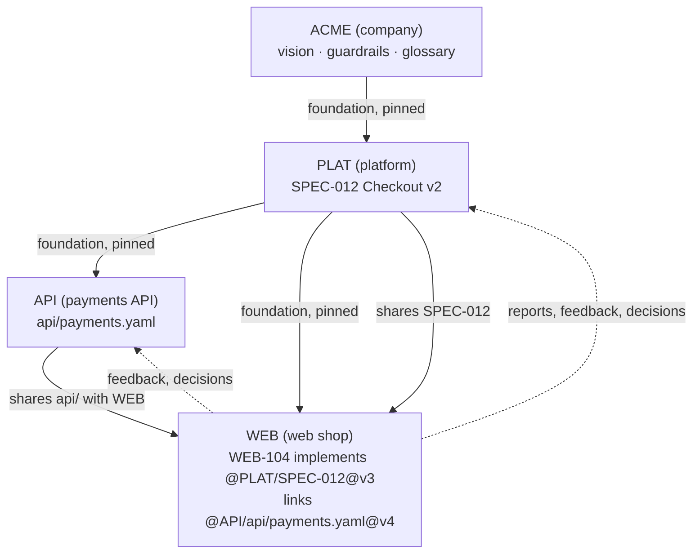

# Shared specs: parent, child and sibling teams

Status: **concept**, nothing of this is built yet. The decisions taken so far are listed at the end.

## The problem

Everything in Garten belongs to exactly one team: specs, documents, folders, the glossary, the guardrails, the Git repository and every agent token. That isolation is a feature, but real organisations are nested and connected:

- a **company** has guardrails every team must follow ("never store card numbers", "all services log in JSON") and a shared vocabulary,
- a **platform team** owns API contracts, ADRs and data models that product teams build against,
- an **API team** offers an API that a product team (a sibling, not a child) uses,
- a **program** writes one spec ("Checkout v2") that three teams implement in their own repositories.

Today the only cross-team mechanism is the instance-wide glossary, which teams import as copies. Everything else is copy & paste, and copies drift.

## Recommendation in one paragraph

Teams form a **tree** (each team has at most one parent team). The tree carries the **foundation**: a child team inherits the vision, strategy, guardrails and glossary of its ancestors, layered by fixed rules (section 3). On top of the tree, any team can **share** released specs, documents and folders with **other teams**: its child teams, or any named team such as a sibling that uses its API. The receiving team sees them read-only and addresses them with the owner's team key (`@API/api/payments.yaml`). Every link points to **one released version**; moving to a newer version is an **approval in the receiving team**. A spec can say it **implements** a spec of another team; the owner sees the reports of all implementing teams rolled up. Content flows to the receiving team; feedback, decisions and reports flow back to the owner.

Only released content crosses a team boundary. Drafts stay private, exactly as today; no other team ever sees them, parents included.



## Why this model and not another

| Approach                                                 | How it works                                                                      | Verdict                                                                                                                                                                 |
| -------------------------------------------------------- | --------------------------------------------------------------------------------- | ----------------------------------------------------------------------------------------------------------------------------------------------------------------------- |
| **Copy on share** (like the global glossary)             | The receiving team imports a copy                                                 | Simple, but drift is the default; nobody knows which copy is current. Kept only as the escape hatch (_Adopt_).                                                          |
| **Shared ownership** (one item belongs to several teams) | Item rows get several owners                                                      | Breaks the per-team Git repository, the per-team roles and the per-team agent tokens all at once. Rejected.                                                             |
| **Link to a released version** (recommended)             | The receiving team references one released version of the owner's item, read-only | One source of truth, fits the existing release model (Git commit + tag per version), every release of the receiving team names the exact versions it was built against. |

**Tree for the foundation, links for everything else.** Layering guardrails and glossary needs an unambiguous order ("nearest wins", "rules add up"), and a tree gives that. Sharing a single document or spec needs no order at all, so it works between any two teams. Siblings therefore never inherit each other's foundation; they only share explicit items.

## Concepts and words

Following `docs/UI-VOCABULARY.md`: one word per idea.

| Idea                                                    | Word                                              | Not                      |
| ------------------------------------------------------- | ------------------------------------------------- | ------------------------ |
| The team above / below in the tree                      | **Parent team** / **Child team**                  | org, sub-team, workspace |
| Foundation documents a team receives from its ancestors | **Inherited** (section _Inherited from ACME_)     | merged, global           |
| A team makes released items visible to other teams      | **Share** (_Share with teams…_)                   | publish, expose          |
| An item of another team as the receiving team sees it   | **Shared** (chip _From API_)                      | external, imported       |
| A spec builds (part of) a spec of another team          | **Implements** (front matter `implements:`)       | child of, realises, epic |
| The version of a shared item a team builds against      | **Pinned version** (_v4_, _Update available: v5_) | locked, frozen           |
| A team takes a shared item as its own editable copy     | **Adopt** (_Adopt as own copy_)                   | fork, clone, import      |

## 1. The team tree

- `teams.parent_id` (nullable). Depth limited to 4 levels; no cycles (checked on every change).
- **Linking needs both sides:** the parent's admin sends a link request, the child's admin accepts it (_Team → Parent team_). An instance admin can link directly. The child agrees to inherit binding guardrails.
- **Unlinking** can be done by either admin. Inherited foundation documents disappear from the child's context; the child is asked whether to _Adopt_ them as its own documents first.
- Deleting a team with children: the children move up to the grandparent (or become roots). Never cascade.
- Membership is **not** inherited. Being an approver in PLAT does not make you anything in WEB.
- A parent team **never sees drafts** of its children. It sees only what the children release and the reports on specs that implement one of its own specs (section 5).

## 2. Sharing items with other teams

| What                                                                     | Who receives it                                                                                                      | How                                            |
| ------------------------------------------------------------------------ | -------------------------------------------------------------------------------------------------------------------- | ---------------------------------------------- |
| Foundation documents and glossary terms                                  | Child teams and their descendants                                                                                    | Automatically, through the tree (section 3)    |
| Custom spec types                                                        | Child teams and their descendants                                                                                    | Automatically; a type is labeled _From PLAT_   |
| A document, a folder (everything below it, also later additions), a spec | The teams the owner names: child teams, all descendants, or any other team on the instance (sibling, unrelated team) | Explicit share, accepted by the receiving team |

**Sharing with a team outside one's own subtree** (the API case): the owner's approver chooses _Share with teams…_ and names WEB. WEB's admin or approver accepts once (_Shared with us → Accept_); from then on WEB's members and agents can read and link everything in that share, including items added to a shared folder later. A share can be ended by either side; links that still point to it keep their pinned version (section 4).

**No passing on.** A receiving team cannot share a shared item further. Only the owner decides who sees its content; WEB that wants SHOP to see `@API/api/payments.yaml` asks API.

**The owner sees who uses what.** Every shared item shows _Used by_: the receiving team, its released specs that link the item, and the pinned version. API sees that WEB is still on v4 while v6 is out. This shows only released specs of the receiving team, never drafts.

Table `shares (team_id, item_id, kind, audience, created_by, created_at)` with `audience` = `children`, `descendants` or `teams`, plus `share_teams (team_id, item_id, to_team_id, accepted_by, accepted_at)` for named teams. A folder share matches by path prefix, so moves and renames in the owner (which already rewrite links) just update the share row.

## 3. Layering of foundation documents

### Every link is pinned, also for the foundation

A child team builds against one fixed state of its ancestors' foundation. Each foundation release of a team (one Git commit; glossary changes are already bundled into one commit) gets a version: `foundation/v7`. The child pins **"PLAT foundation v7"** as a whole, not every single document or term.

When PLAT releases foundation v8, the child sees _Update available: PLAT foundation v8_ with the diff of every changed document and term. An **approver of the child team** accepts it; that is a release of the child's foundation, so it triggers exactly what an own guardrail change triggers today (`guardrails_changed` for implemented specs, the agent trigger). Until then the child's agents keep working with v7.

Rules from above can still not be ignored silently: the Garden of the child shows _Inherited update waiting since 12 days_ under _Needs attention_, and the parent sees under _Used by_ which children are still on an older foundation version.

**Required updates (optional, per rule).** An approver of the parent can mark a new or reworded guardrail as _required by \<date\>_. The child sees the date with the update. If the child has not accepted the foundation update by then, **only that rule** is applied to the child automatically: it joins the child's guardrails, `guardrails_changed` fires for implemented specs, and the audit log records it. The rest of the foundation update (vision, glossary, other rules) stays waiting for the child's approval. This works because every rule is its own file (section 3a). Without a date, nothing is ever forced.

### Two vision documents: nothing is overwritten

Every team has its own vision, strategy and guardrails. With a parent there are now two (or more) of each. They do not need to be linked and none overwrites another. Each kind of document has one rule:

| Document                                               | Rule                                                                                                                                                                                                                                                  | Agent sees                                            |
| ------------------------------------------------------ | ----------------------------------------------------------------------------------------------------------------------------------------------------------------------------------------------------------------------------------------------------- | ----------------------------------------------------- |
| Guardrails (`guardrails/`, section 3a)                 | **Add up.** All rules of all ancestors apply, plus the own ones. A child cannot delete, reword or relax a parent rule; to disagree it gives feedback on the parent's guardrails. Rule ids carry the team key (`ACME/G1`) so reports stay unambiguous. | One list, grouped by team, top-down                   |
| `vision.md`, `strategy.md`, other foundation documents | **Stack.** Each document stays as written. The own document comes first, then the ancestors' ones, each labeled with its team. They are context, not rules: the own vision says where this team is heading, the parent's says what it is part of.     | All of them, own first                                |
| Glossary terms                                         | **Nearest wins.** A child's term with the same name shadows the parent's inside the child. _Health_ shows it as _Shadows ACME's term_, so it is a conscious decision. `avoid` words of all ancestors still apply.                                     | One merged glossary, every entry with its source team |

If a child's vision or strategy contradicts the parent's, that is not resolved by an order of precedence but by people: _Health_ cannot detect it, but an agent that notices a contradiction while building asks with `request_decision` (the instructions say so). Guardrails are the only place where the parent always wins, because they are rules.

What `get_team_context()` returns for WEB:

```
# Team context – WEB  (inherits ACME foundation v12 › PLAT foundation v7)

> GUARDRAILS are binding. Rules of parent teams apply and cannot be relaxed.

## Guardrails
### ACME
- ACME/G1: Never store card numbers.
### PLAT
- PLAT/G3: Every public endpoint is documented in api/.
### WEB
- G1: …

## Vision
### WEB
…
### PLAT (parent)
…
### ACME (company)
…

## Strategy   (same order)
## Glossary   (merged, nearest definition wins, source team in every entry)
```

## 3a. Guardrails as files, like the glossary

**Today** all rules of a team live in one document, `guardrails.md`: a line `- G1: text` under `## Always` or `## Never` (`shared/guardrails.js`). A rule is an id and one line of text; a report records `{ G1: text }`, and a new or reworded line puts implemented specs on the work list as `guardrails_changed`. That is enough for one team with a dozen rules. It gets thin once rules are inherited, required by a date, and read by agents of many teams:

- a rule has no room for **why** it exists, examples or exceptions, so agents follow the letter and miss the intent;
- there is no **history per rule** (only of the whole file), and no way to say which rule a parent marked as required;
- every rule goes to every task, even when it only concerns APIs or data;
- agents cannot **propose** a rule the way they propose glossary terms.

**Proposal:** a guardrail is a Markdown file, exactly as a glossary term is: `guardrails/<folder>/<slug>.md`, sub-folders group rules (`security/`, `api/`, `operations/`).

```markdown
---
id: G7
rule: 'Never store card numbers, not even truncated or encrypted.'
kind: never # always | never
applies_to: [api, data-model] # spec types and/or folders; empty = every task
see: [G3, '[[Card token]]']
required_by: 2027-01-31 # parent teams only, optional (section 3)
---

**Why:** PCI DSS scope. Every system that stores a PAN is in scope of the audit.

**Instead:** store the token from the payment provider (`#[Card token]`).

**Exceptions:** none. Ask with `request_decision` if a task seems to need one.
```

What each part does:

| Part            | Purpose                                                                                                                            | Triggers `guardrails_changed`?                                  |
| --------------- | ---------------------------------------------------------------------------------------------------------------------------------- | --------------------------------------------------------------- |
| `id`            | Stable, assigned by the server (`G1`, `G2` …), never reused, independent of the file name. Inherited rules are shown as `ACME/G7`. | –                                                               |
| `rule`          | The binding sentence. Exactly what an agent must follow.                                                                           | **Yes**, when added or reworded (as today)                      |
| `kind`          | _Always_ / _Never_, as today's sections                                                                                            | Yes                                                             |
| `applies_to`    | Spec types and/or document folders the rule concerns; empty means all                                                              | Yes, for specs that now fall under it                           |
| Body (Markdown) | Why, examples, what to do instead, exceptions. Agents read it to apply the rule sensibly.                                          | **No**: explaining a rule better does not make built code wrong |
| `see`           | Related rules and glossary terms                                                                                                   | No                                                              |
| `required_by`   | Section 3: forced on child teams after this date                                                                                   | –                                                               |

What this gives, mostly by reusing what the glossary already has:

- **One page like _Glossary_:** folder tree, rule, rationale, _Used in_ (reports that were built against it), _History_ (Git log of the file).
- **Proposals:** agents propose rules with `propose_guardrail` into `guardrails/_proposed/` (never released); _Make it a rule_ on feedback or a deviation does the same for people. Only approvers accept, as with proposed terms.
- **Health:** two rules saying the same thing, an _Always_ contradicting a _Never_, a child rule that contradicts an inherited one, rules no report was ever built against, rules pointing to unknown terms.
- **Release:** like term files: changes are debounced into **one** commit per team (the foundation release, so one foundation version, section 3).
- **For agents, nothing gets slower:** `get_team_context()` still lists every applicable rule as one line (`ACME/G7 (never): …`), so one call is still enough to know all rules. New `get_guardrails(spec?)` returns full rules with rationale, filtered by `applies_to` for that spec, like `get_glossary(spec)`. A generated `GUARDRAILS.md` in the repository keeps the overview for people and for agents without MCP.
- **Reports** keep recording `{ id: rule }`, now with the team key for inherited rules; drift detection stays the same function.

**Migration** (the same path the glossary took from `glossary.md`): at the first start after the update, every `- Gn: text` line becomes a file with `id: Gn`, `kind` from its section, `rule` = the text and an empty body; other `##` headings become folders. Ids stay, so existing reports keep matching. If `guardrails.md` was released, the folder is released in one commit and `guardrails.md` leaves the repository.

This change is useful without any sharing and is a good first step (section 10).

## 4. Shared documents and specs

**Addressing.** Shared items are referenced with the owner's team key and always with a version: `@API/api/payments.yaml@v4`, `@PLAT/SPEC-012@v3`. The `@` mention menu in the editor gets a section _From other teams_ and inserts the newest released version.

**Updating is an approval.** The pin lives in the link inside the receiving team's spec. When API releases `payments.yaml` v5, every spec in WEB that links v4 shows _Update available: v5_ with the diff. _Update link_ changes the link in a draft; approving that draft releases a new version of WEB's spec. That is the existing flow: the agent sees the spec as `changed`, and `get_spec_changes` shows the new link with the diff of the shared document. A bulk action _Update everywhere_ makes one draft per affected spec; an approver still approves them.

**Released front matter.** A released spec lists every shared item with its version, so it is reproducible:

```yaml
documents:
  - api/internal-notes.md
  - '@API/api/payments.yaml@v4'
implements: '@PLAT/SPEC-012@v3'
```

**Owner revokes or stops sharing.** Released specs of the receiving team keep their pinned version: the server keeps serving that version to the teams whose released specs link it (released versions are immutable Git tags, nothing has to be copied). The receiving team sees _Revoked by API_ under _Needs attention_; a new release that still links the item shows a warning and offers _Adopt as own copy_ or removing the link.

**In the app.** The documents tree gets a section per owning team (_From API_), read-only, showing the pinned versions in use and newer ones. Offline: shared items are synced like own items, read-only, in a separate stream per owning team; only released versions are sent.

## 5. Specs that implement other teams' specs (`implements`)

- A spec names the spec it implements: `implements: @PLAT/SPEC-012@v3`. Works for any shared spec (parent, sibling) and, without prefix, inside one team (`implements: SPEC-007`), which gives epics and sub-specs for free.
- _New spec implementing this…_ on a shared spec creates a draft with the link, the type, and the owner's acceptance criteria as a starting checklist (`get_criteria` already extracts them).
- **Rollup at the owner.** The owner's spec shows _Implemented by_: one row per implementing spec with its team, the version it implements, and its latest report status. The owner's spec counts as implemented when all implementing specs report `implemented` against its current version. Only released specs and their reports are visible, never drafts.
- **A new owner version** shows _Update available: v4_ in each implementing team, like any other pinned link. When the implementing team approves the update, its agent gets the spec as `changed` with the owner's diff. Until then nothing moves, as decided.

## 6. What flows back to the owner

- **Feedback** on a shared or inherited item (from a member or an agent of the receiving team via `add_feedback`) lands in the **owner's** feedback queue, labeled with the source team. The owner answers; the receiving team sees the answer. This is also how a child disagrees with a parent guardrail.
- **Decisions** (`request_decision`) on a shared spec: same. The asking agent sees `decision_answered` in its work list when the owner answers.
- **Reports** of specs that implement the owner's spec (rollup above).
- Rate limits count per writing team, so a busy receiving team cannot flood the owner.

## 7. Permissions

| Action                                                                         | Who                                                                           |
| ------------------------------------------------------------------------------ | ----------------------------------------------------------------------------- |
| Request / accept a parent link                                                 | Team admins of both teams (or an instance admin)                              |
| Share / stop sharing items                                                     | Approver or admin of the owning team                                          |
| Accept a share from another team                                               | Approver or admin of the receiving team                                       |
| Read shared and inherited items                                                | Every member and agent of the receiving team                                  |
| Edit a shared or inherited item                                                | Nobody outside the owning team                                                |
| Link a shared item in a draft, Adopt as own copy                               | Editor or above in the receiving team                                         |
| Accept an update (new pinned version of a link or of the inherited foundation) | Approver or above in the receiving team: it changes what agents build against |
| Feedback / decisions on shared items                                           | Same rights as on own items; answered by the owning team                      |

Agent tokens stay bound to one team. An agent of WEB reads shared content through WEB's MCP server; it never gets a token for API or PLAT.

## 8. Agents: fast and simple

Decision: agents read shared content **through MCP only**, from the owner's released Git versions. Nothing is copied into the receiving team's Git repository.

Why this is the fastest and simplest option:

- **No extra calls for the foundation.** `get_team_context()` stays one call and already contains the inherited guardrails, vision, strategy and glossary at the pinned versions.
- **Same tools, same shapes.** `get_spec('@PLAT/SPEC-012')` and `get_document('@API/api/payments.yaml')` work like the own ones; the version defaults to the one the team has pinned, so the agent never has to work out which version applies. List results gain `team` and `shared: true`, nothing else changes.
- **Cheap on the server.** A released version never changes, so `(team, path, version)` is cached for good; a read is a cache hit or one `git show` in the owner's repository, as today.
- **No copies to keep in sync.** Copies in the receiving repository would need sync commits, conflict handling for monorepos (owner and receiver pushing to the same remote) and would double what agents have to look at.

MCP changes in detail:

- `get_team_context` – layered, as in section 3.
- `list_specs`, `list_documents` – shared items the team uses or may use, with `team`, `shared: true`, `pinned_version`, `newest_version`. `include_shared=false` leaves them out.
- `get_spec`, `get_document` – accept `@KEY/…`; without `version` they return the pinned one.
- `get_glossary` – merged, every entry with its source team.
- `get_work_list` – unchanged states. Shared specs themselves are never on a team's work list; the team implements its own spec that `implements` them.
- `create_draft_spec`, `update_draft_spec` – accept `implements` and `@KEY/…@vN` links. Agents cannot approve, so they cannot move a pin either; they can propose an update in a draft.
- `add_feedback`, `request_decision` – accept shared ids; routed to the owner.

## 9. Data model sketch

```sql
ALTER TABLE teams ADD COLUMN parent_id TEXT REFERENCES teams(id);
ALTER TABLE teams ADD COLUMN foundation_version INTEGER NOT NULL DEFAULT 0;  -- bumped per foundation release (Git tag foundation/vN)
CREATE TABLE team_links (                 -- pending parent link requests
  parent_id TEXT, child_id TEXT, requested_by TEXT, created_at TEXT,
  PRIMARY KEY (parent_id, child_id));
CREATE TABLE foundation_pins (            -- which foundation version of each ancestor a team builds against
  team_id TEXT, ancestor_id TEXT, version INTEGER, accepted_by TEXT, accepted_at TEXT,
  PRIMARY KEY (team_id, ancestor_id));
CREATE TABLE shares (
  team_id TEXT, item_id TEXT, kind TEXT,  -- spec | doc | folder
  audience TEXT NOT NULL,                 -- children | descendants | teams
  created_by TEXT, created_at TEXT,
  PRIMARY KEY (team_id, item_id));
CREATE TABLE share_teams (                -- audience = teams: who it is shared with, and who accepted
  team_id TEXT, item_id TEXT, to_team_id TEXT, accepted_by TEXT, accepted_at TEXT,
  PRIMARY KEY (team_id, item_id, to_team_id));
ALTER TABLE items ADD COLUMN implements TEXT;       -- "@PLAT/SPEC-012@3" or "SPEC-007@2"
ALTER TABLE items ADD COLUMN origin TEXT;           -- adopted copies: "API/api/payments.yaml@4"
ALTER TABLE feedback ADD COLUMN from_team_id TEXT;  -- feedback from a receiving team
```

Pins of shared documents and specs need no table: they are the versions in the links of the receiving team's specs. _Used by_ is a query over those links.

## 10. Rollout in steps

Each step is useful on its own:

0. **Guardrails as files** (section 3a), with migration, proposals and Health. No sharing needed.
1. **Team tree and inherited foundation.** `parent_id`, link requests, foundation versions and pins, layered `get_team_context`, updates accepted by an approver. Biggest value (company-wide rules), no new item kinds.
2. **Sharing documents and folders.** Shares to children and to named teams, `@KEY/…@vN` links, _Update available_ and _Update link_, _Used by_ at the owner, read-only tree section.
3. **`implements` and rollup.** Specs implementing other teams' specs, _Implemented by_, feedback and decisions routed to the owner.
4. **Adopt, unlink, criteria mapping (`AC2 → @PLAT/SPEC-012#AC4`), global glossary as the glossary of a root team.**

## 11. Edge cases

- **Moving a team in the tree** changes its inherited guardrails. The new parent's foundation starts as _Update available_; nothing applies until an approver accepts.
- **A shared spec of a custom type** the receiving team does not have: the released Markdown carries everything needed to render it; the form view is offered only when the type is known.
- **Glossary `avoid` conflicts:** the parent says "never say _client_", the child defines _Client_. Health shows the conflict; the parent's `avoid` wins for agents unless the child marks its term as a deliberate override.
- **Offline device, owner releases meanwhile:** nothing changes for the device, since pins only move by approval. On sync the update hint appears.
- **Owner team is deleted:** its shared items are gone for everybody; before deletion the admin sees the _Used by_ list, and receiving teams are offered _Adopt as own copy_.
- **Instance with one team:** nothing changes; all of this stays invisible until a second team is linked or something is shared.

## Decisions

1. **Sharing beyond the tree:** yes. Documents, folders and specs can be shared with any named team (e.g. an API team with the product that uses the API), accepted by the receiving team. Foundation documents are inherited only through the tree.
2. **Drafts:** parent teams never see drafts of child teams. They see released specs and reports on specs that implement their own.
3. **Agent access:** through MCP from the owner's released versions, with caching; no copies in the receiving team's Git repository. Keeps calls few and the moving parts minimal.
4. **Versions:** every link is pinned to one released version, the inherited foundation as well. Moving to a newer version is an approval in the receiving team.
5. **Two vision documents:** none is overwritten and they need no linking. Vision and strategy stack (own first, ancestors labeled), guardrails add up, glossary terms resolve nearest-first.

6. **Required guardrail updates:** optional per rule. A parent approver can set _required by \<date\>_; after it, only that rule is applied to the child automatically.
7. **Who can share with whom:** any team with any other team on the instance, accepted by the receiving team.
8. **Guardrails** become one file per rule, like glossary terms (section 3a): binding sentence, kind, scope and id in front matter, rationale in the body. Only changes to the binding parts trigger `guardrails_changed`.

## Still open

- Is `applies_to` (rules per spec type or folder) worth it, or should every rule keep going to every task? It shortens what agents read, but a wrongly scoped rule is silently missing.
- Should there be a third kind besides _Always_ and _Never_, such as _Prefer_ (a strong default that may be broken with a reason in the report, without asking)?
